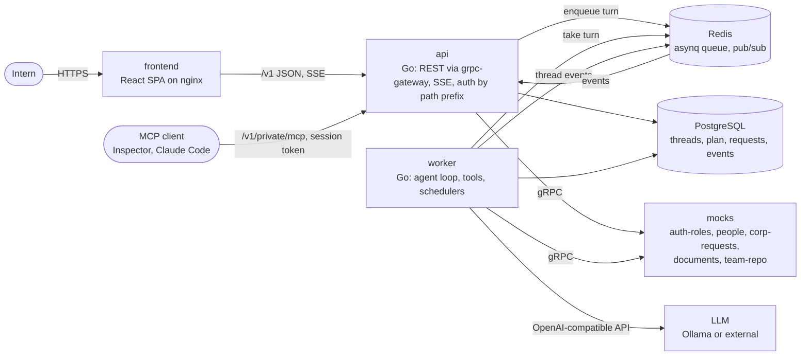
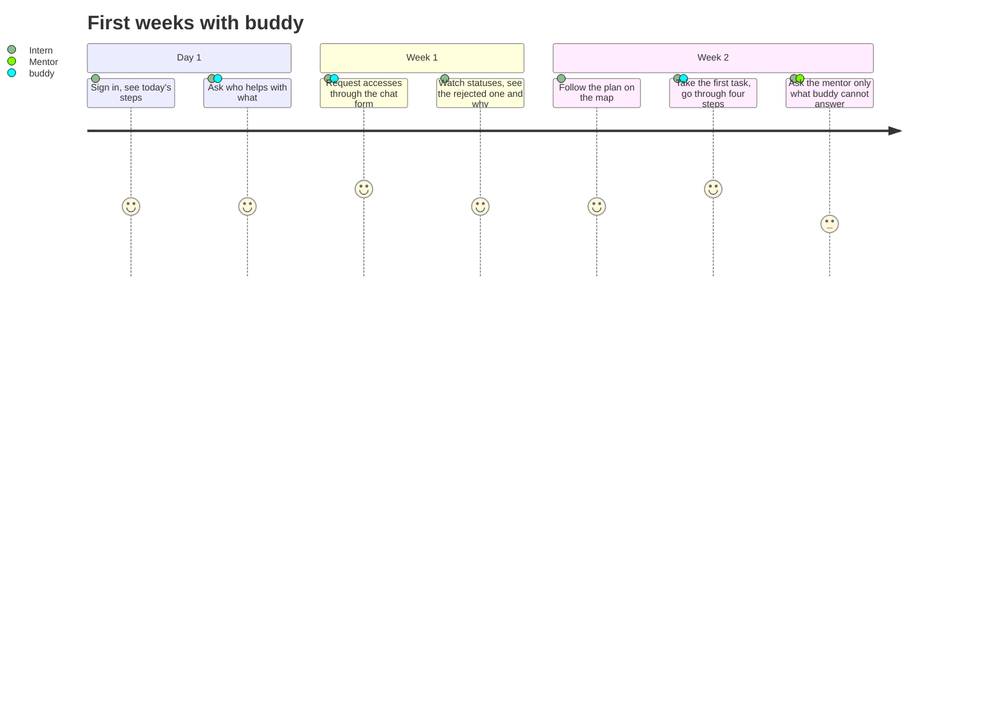

# AI-buddy

An AI mentor for Avito interns: it answers work questions with sources, leads through the onboarding plan, and
does routine actions through the company's services (simulated here). Prototype for the Hack&Change 2026 case.
All data is synthetic; instructions in the data are training ones, not Avito regulations.

## Quick start

Requirements: Docker with Compose, and a model (see below). Everything else runs in containers.

```bash
git clone https://github.com/Long-Honey-Road/mon-europeenne.git
cd mon-europeenne
cp deploy/.env.example deploy/.env
docker compose -f deploy/docker-compose.yml up -d --build --wait
```

Open http://localhost:3000 and sign in with a test account. `deploy/smoke.sh` checks the running stack: login,
profile, plan, people, an access request approved by the mock request system, one chat turn over SSE.

The mock company services answer REST on http://localhost:8090 for checking by hand, e.g.
`curl localhost:8090/people` or `curl -H 'x-mock-fail: 503' localhost:8090/teams` to see a failure.

The `docs/` submodule is a private repository with the product and design documents (in Russian); the app and
this README work without it. With access to it, clone with `--recurse-submodules`.

## Model providers

The worker calls any OpenAI-compatible chat API, set in `deploy/.env`:

| Provider | `deploy/.env` |
|---|---|
| Ollama on the host (default) | `LLM_BASE_URL=http://host.docker.internal:11434/v1`, `LLM_MODEL=qwen3.6:35b-a3b`, `LLM_API_KEY=ollama` |
| Ollama inside compose | `COMPOSE_PROFILES=ollama`, `LLM_BASE_URL=http://ollama:11434/v1`; the first start pulls `LLM_MODEL` into a volume |
| External provider | its OpenAI-compatible base URL in `LLM_BASE_URL`, model in `LLM_MODEL`, key in `LLM_API_KEY` |
| No model | `LLM_PROVIDER=fake`: every question gets a fixed text; enough for the UI and CI, not for the scenarios |
| Several sources | `LLM_ENDPOINTS` as a JSON list of `{name, base_url, api_key, model, max_concurrency}` (example in `deploy/.env.example`); overrides `LLM_BASE_URL` |

Each endpoint serves `max_concurrency` answers at once (`LLM_MAX_CONCURRENCY` for `LLM_BASE_URL`, 1 by default).
Extra answers wait in a queue for up to `LLM_QUEUE_TIMEOUT` (5m) with a "queued" status in the chat; one answer
stays on one endpoint, and an endpoint that fails before answering hands the turn to the next one.

`qwen3.6:35b-a3b` needs about 24 GB of RAM or VRAM; on a smaller machine use a smaller model of the same family
or an external provider. `LLM_REASONING_EFFORT=none` turns Qwen thinking off, which keeps tool calls fast. Secrets
are read from the environment only; `deploy/.env` is not committed.

## Test accounts

Synthetic, from `backend/seed/people.json`; the login page has buttons that fill them in.

| Login | Password | Role |
|---|---|---|
| `intern` | `intern-demo` | intern, backend, team Messenger |
| `mentor` | `mentor-demo` | mentor |
| `manager` | `manager-demo` | manager of the team |

## How to check the scenarios

Sign in as `intern`. The screen is four orbs and the buddy chat on the right.

1. **Today.** Click «Сегодня»: day and stage of onboarding, next steps, blockers. A step puts a question about
   it into the chat.
2. **Who to ask.** In the chat: «Кто поможет с деплоем?». The answer names a person with a card (role, why,
   contact) and the escalation chain: mentor, manager, HR BP.
3. **Access request (action through a company service).** In the chat: «Нужен доступ к VPN, работаю со стендами из
   дома». Buddy prepares the request; the answer has a form with the fields filled in and who approves it. Check or
   edit the fields and press «Отправить заявку». The card shows the request id and «Ждёт согласования»; about a
   minute later it turns «Одобрено» without a reload. A Sentry request is rejected with a reason, to show the other
   path. Requests also appear in «Задачи» and as blockers in «Сегодня».
4. **Plan.** Click «План»: items by stage, an item card with status buttons. «Открыть карту» shows the plan as
   constellations of spheres with dependencies; «Обсудить в треде плана» moves the chat into the plan thread.
5. **Work task.** «Разобрать рабочую задачу» in «Сегодня» or «Задачи»: a task key opens the task screen with four
   steps (understand, the service, team conventions, check and hand off). Buddy explains each step; it never writes
   the code for the intern.
6. **Team.** Click «Команда»: the directory, own team first, and «Спросить buddy» about a person.

Permissions are checked in the tools and the API, not in prompts: what a role may not see is neither shown nor done.

## Architecture

C4, container level:



- **frontend**: one screen with four orbs and a permanent chat, the plan map, the task screen. TanStack Query and
  Router, Zustand, Zod for every response; the client is generated from `backend/api/openapi/buddy-api.yaml`.
- **api**: contracts in protobuf (`backend/api/proto`), REST through grpc-gateway, paths
  `/{version}/{public|private}/{resource}`, private ones need a session token.
- **worker**: one agent turn per message as an asynq job. The model answers in plain text with `[n]` citations;
  blocks (sources, person, action form) are built by the server from this turn's tool results.
- **Knowledge**: the worker indexes the team wiki (the `documents` mock, synthetic training instructions) and the
  open Avito Playbook (read from GitHub at a fixed commit, with links back; not copied into this repository) into
  Postgres full-text search. `search_docs` filters by the user's team in SQL, so another team's document never
  reaches the model; a general and a team rule on one topic come back as a conflict with both sources.
- **Tools** are the agent's only way to act, each with a JSON Schema, roles and thread types; the API serves the
  same registry over MCP at `/v1/private/mcp` as the signed-in user, `buddy mcp` over stdio as a test user. Sending a request is never a model action: the user confirms the form.
- **Company services** buddy cannot reach are imitated by `buddy mocks`: auth-roles, people, corp-requests, documents and team-repo, each
  with a gRPC contract in `backend/api/proto/mocks` (REST and `backend/api/openapi/mocks-api.yaml` for manual checks),
  random failures and delays (`MOCK_FAIL_RATE`, `MOCK_MAX_LATENCY`). Buddy talks to them like to real services:
  deadlines, retries of reads, the last good copy of the directory during an outage. Pointing `MOCKS_ADDR` at a
  real service replaces a mock without touching the agent.

## Intern journey



## Tests and coverage

```bash
make cover
```

Runs the Go tests (Docker needed: they start Postgres and Redis) and the frontend tests, then merges both into one
line figure with a threshold of 80% (`COVERAGE_MIN` to change). The report is `coverage/summary.md`, the merged lcov
`coverage/lcov.info`, the frontend HTML `coverage/frontend/index.html`. Generated code, mock services, test fakes and
the entry point are excluded, and the summary lists every exclusion. CI runs the same command on every push to
`main` and `develop` and on demand (`gh workflow run ci.yml --ref <branch>`), and keeps `coverage/` as an artifact.

Agent behaviour is specified with spec-kit before code: `specs/`; golden dialogs from the specs are test cases with a
scripted model.

## Decisions where the case was silent

- Interface: a web app with a permanent chat beside the data, not a bare chat.
- Requests are limited to accesses and live in one removable module behind `FEATURE_REQUESTS`.
- A local model through Ollama is the default; any OpenAI-compatible provider is one variable away.
- The full log with reasons is `docs/product/decisions.md`.

## Development

Requirements: Go 1.27, Node 26, Docker (also for tests: they start Postgres via testcontainers). Dev tools
(golangci-lint, buf, protoc plugins) are pinned in `backend/tools.mod` and run via `go tool`, nothing to install.

The stack: `postgres`, `redis`, one-shot `migrate` and `seed`, `api` (HTTP and SSE), `worker` (agent turns from the
queue) and `frontend`, plus `ollama` and `ollama-pull` with the `ollama` profile. `frontend` serves the built app on
http://localhost:3000 (`WEB_PORT`) and proxies `/v1` and `/healthz` to the API, so the browser talks to one origin;
SSE goes through unbuffered. The API itself is on http://localhost:8080 (`API_PORT`).

Chat flow for clients: create a thread, open `GET /v1/private/threads/{id}/events` (SSE) first, then
`POST /v1/private/threads/{id}/messages` (202). Events: `status` (what the agent is doing), `delta` (answer text
as it is generated), `reset` (drop the streamed text), `block` (sources, person, not_found), then `done` with
`message_id` and the final `text` (show it instead of the stream: the server may remove invented links) or
`error` with `escalation`.

Access requests (`FEATURE_REQUESTS=true` by default): the agent prepares a request with `prepare_request` and
the answer gets an `action` block with the filled form; the user sends it with `POST /v1/private/requests`.
Until the corp-requests mock exists, a simulated request system in Redis approves or rejects requests after a
delay from `backend/seed/request_types.json`; the worker checks every 15 s and sends `request_status` to the
thread. `GET /v1/private/today` shows missing, waiting and rejected requests as blockers.

Paths follow `/{version}/{public|private}/{resource}`: `/v1/public/...` needs no session, `/v1/private/...`
needs `Authorization: Bearer <token>` from `POST /v1/public/auth/login`. Contract: `backend/api/openapi/buddy-api.yaml`.

Frontend (from `frontend/`):

| Command | What it does |
|---|---|
| `npm ci && npm run dev` | dev server on http://localhost:5173; `/v1` is proxied to the API on `localhost:8080` |
| `npm test` / `npm run test:coverage` | Vitest with the API mocked by msw |
| `npm run typecheck` | TypeScript check |
| `npm run dev:mock` | dev server on the fake API from the tests (msw in the browser), no backend needed |
| `npm run gen:api` | regenerate `src/api/schema.gen.ts` from `backend/api/openapi/buddy-api.yaml` |

From `backend/`:

| Command | What it does |
|---|---|
| `make test` | unit tests |
| `make cover` | tests with coverage, generated code excluded |
| `make lint` | golangci-lint, buf lint and proto format check |
| `make gen` | regenerate Go, gRPC, grpc-gateway and OpenAPI from `api/proto` |
| `make run CMD=api` | run a `buddy` subcommand |
| `make run CMD="migrate up"` | apply migrations to `DATABASE_URL` (`down` reverts all) |
| `make run CMD=llm-check` | probe the model from `LLM_*` env: plain answer, tool call, JSON by schema, stream |
| `make run CMD='ask -v Кто поможет с деплоем?'` | one agent turn as `intern` (`-as`, `-thread`, `-detailed`); `-v` prints tool calls |
| `make run CMD='trace -n 5 -as intern'` | the latest saved agent turns: prompt (`-prompt`), tool calls with arguments and results, text before cleanup; in compose `docker compose -f deploy/docker-compose.yml exec api buddy trace` |

### MCP

The API serves the agent's tools over MCP streamable HTTP at `/v1/private/mcp`, as the user of the session
token, with the same checks as the agent: `tools/list` shows what the role may use in the thread type, `tools/call`
of anything else answers `{"error": "forbidden" | "not_in_thread" | "unknown_tool"}` with `isError`. The thread type
is `general` unless the URL says otherwise (`?thread=plan`, `request`, `task`); it is fixed when the session starts.
Without a token the endpoint answers 401; a session ID presented with another user's token gets 403.

1. Start the stack (`docker compose -f deploy/docker-compose.yml up`) and get a token:

   ```bash
   curl -s localhost:8080/v1/public/auth/login -d '{"login":"intern","password":"intern-demo"}'
   ```

2. Run `npx @modelcontextprotocol/inspector`, pick transport **Streamable HTTP**, URL
   `http://localhost:8080/v1/private/mcp` (or `...?thread=plan`), and in **Authentication** set the header
   `Authorization` to `Bearer <token>`. Connect, then **List Tools** and run one, for example `get_plan`.

Claude Code takes the same endpoint:

```bash
claude mcp add --transport http buddy http://localhost:8080/v1/private/mcp --header "Authorization: Bearer <token>"
```

The token lives 12 hours. Behind a proxy that reaches the API on localhost, keep the original `Host` header: the
MCP SDK refuses requests that arrive on a loopback address with a foreign host (DNS rebinding protection).

`buddy mcp` serves the same tools over stdio as a test user in one thread type, no API needed; with `DATABASE_URL`
the plan and request tools are there too. For Claude Code, from the repo root:

```bash
claude mcp add buddy -- go -C backend run ./cmd/buddy mcp -as intern -thread plan
```

Or MCP Inspector: `npx @modelcontextprotocol/inspector go -C backend run ./cmd/buddy mcp`.

Contracts live in `backend/api/proto` (source of truth). `backend/gen` and
`backend/api/openapi/buddy-api.yaml` are generated and committed; CI fails if they are stale.

## Documentation and agent rules

Requirements of the case, product decisions, design and the plan are in the `docs/` submodule
(`Long-Honey-Road/ochre-stonecrop`, private, in Russian): start at `docs/README.md`. Update it before work with
`git submodule update --init --remote docs`. Rules for AI agents: `docs/CLAUDE.md` (copy in `docs/AGENTS.md`) and
`docs/agents/workflow.md`.
